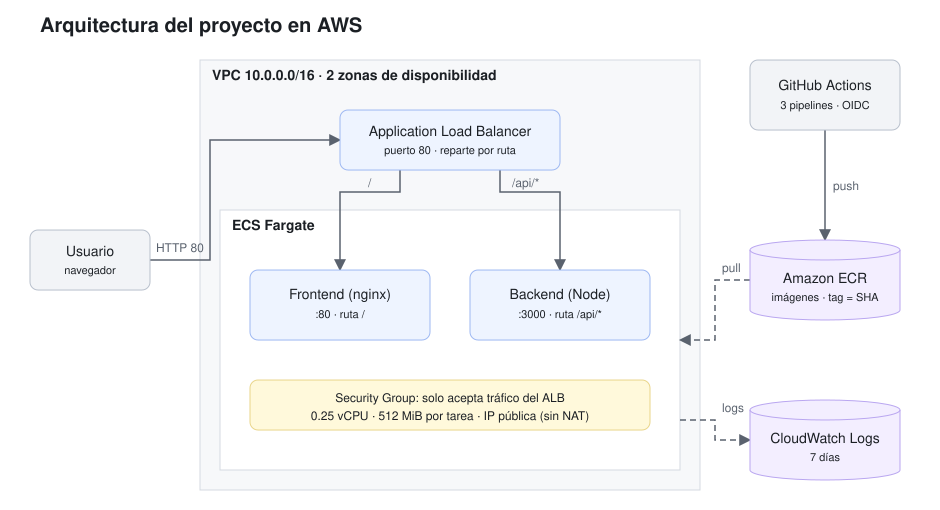

# Proyecto final: tres pipelines DevOps en AWS

Una aplicación web (frontend + backend) que se **aprovisiona con Terraform**, se **construye y publica en Amazon ECR** y se **despliega en Amazon ECS (Fargate)**, todo automatizado con **GitHub Actions**.

Este documento es la **guía única del equipo**: explica *qué* hace cada pieza, *por qué* se eligió así y *cómo* ejecutarla. Está pensado para que cualquier integrante pueda sustentar la demo.

## Contenido

0. [Conceptos desde cero (léelo primero)](#0-conceptos-desde-cero)
1. [Visión general](#1-visión-general)
2. [Arquitectura y por qué cada servicio](#2-arquitectura-y-por-qué-cada-servicio)
3. [Los tres pipelines](#3-los-tres-pipelines)
4. [Credenciales y manejo de errores](#4-credenciales-y-manejo-de-errores)
5. [Requisitos previos](#5-requisitos-previos)
6. [Paso a paso para reproducir](#6-paso-a-paso-para-reproducir)
7. [Guion de la demo](#7-guion-de-la-demo)
8. [Costos y apagado](#8-costos-y-apagado)
9. [Problemas frecuentes](#9-problemas-frecuentes)
10. [Preguntas probables de la sustentación](#10-preguntas-probables-de-la-sustentación)
11. [Trazabilidad: requisito → archivo](#11-trazabilidad-requisito--archivo)

---

## 0. Conceptos desde cero

> No necesitas saber nada de esto de antemano. Si un término aparece más adelante y no lo recuerdas, vuelve aquí.

### La nube y AWS
- **AWS** (Amazon Web Services) alquila computadores, redes y herramientas por internet y cobra por lo que usas. En vez de comprar un servidor, "pides" uno con un clic o con código.
- **Región**: ubicación geográfica de AWS (ej. `us-east-1`, Virginia). Elegimos una y todo vive ahí.
- **Zona de disponibilidad (AZ)**: un centro de datos concreto dentro de la región. Usar dos significa que si una falla, la otra sigue funcionando.
- **Consola de AWS**: la página web donde ves y administras tus recursos. Todo lo que creemos con código también se verá ahí.

### Terraform (infraestructura como código)
- **El problema**: crear una red, un balanceador y un clúster a mano en la consola son decenas de clics que nadie recuerda ni puede repetir igual.
- **Terraform** es una herramienta donde **escribes en archivos de texto qué infraestructura quieres** (como un plano de una casa) y él la construye en AWS. Esto se llama *Infraestructura como Código* (IaC). Ventajas: se puede repetir, revisar en Git, y borrar todo con un comando.
- Piezas que verás en los archivos `.tf`:
  - **provider**: el "plugin" que sabe hablar con AWS.
  - **resource**: una cosa concreta a crear (ej. `aws_vpc` = una red, `aws_ecr_repository` = un repositorio de imágenes).
  - **variable**: un valor configurable (ej. la región). **output**: un dato que Terraform te muestra al terminar (ej. la URL de la app).
- **State (estado)**: un archivo donde Terraform anota *qué ya creó*, para saber qué cambiar la próxima vez. Es sensible, por eso no va a Git sino a un bucket S3.
- Los 4 comandos que debes conocer:

| Comando | Qué hace |
|---|---|
| `terraform init` | Descarga los plugins y conecta con el lugar del state. Siempre primero. |
| `terraform plan` | **Simula**: muestra qué crearía, cambiaría o borraría. No toca nada. |
| `terraform apply` | Ejecuta el plan y crea la infraestructura de verdad (cuesta dinero). |
| `terraform destroy` | Borra todo lo que creó. Se usa al terminar la demo. |

### Docker (contenedores)
- **Contenedor**: una caja que trae tu aplicación con todo lo que necesita para correr. Funciona igual en tu laptop, en GitHub o en AWS.
- **Dockerfile**: la receta de texto para armar esa caja. **Imagen**: el resultado de seguir la receta (el "molde"). Un contenedor es una imagen en ejecución.
- **Registro de imágenes**: un almacén de imágenes. El de AWS se llama **ECR**. Cada imagen lleva una **etiqueta (tag)**, aquí el identificador del commit.

### Servicios de AWS que usamos (una frase cada uno)
| Servicio | Qué es, en simple |
|---|---|
| **VPC** | Tu red privada dentro de AWS. Nada entra ni sale sin tu permiso. |
| **Subred** | Un pedazo de la VPC, ubicado en una zona de disponibilidad. |
| **Internet Gateway** | La puerta que conecta la VPC con internet. |
| **Security Group** | Un firewall: lista qué tráfico puede entrar a un recurso. |
| **ECR** | Almacén privado de imágenes Docker. |
| **ECS** | El servicio que ejecuta contenedores y los mantiene vivos. |
| **Fargate** | Modo de ECS en el que AWS pone los servidores; tú solo dices cuánta CPU y memoria. |
| **Task definition** | La "receta" de ECS: qué imagen, cuánta memoria, qué puerto. |
| **Service (de ECS)** | Garantiza que siempre haya N copias (tareas) corriendo y reemplaza las que fallan. |
| **ALB (balanceador)** | Recibe las visitas de internet y las reparte entre los contenedores sanos. |
| **CloudWatch Logs** | Donde se guardan los mensajes (logs) que imprimen tus contenedores. |
| **S3** | Almacenamiento de archivos. Aquí guarda el state de Terraform. |
| **IAM** | El sistema de permisos: quién puede hacer qué en AWS. |

### Permisos (IAM)
- **Rol**: una "identidad" con permisos que alguien (una persona, un servicio o un pipeline) puede **asumir** temporalmente.
- **Política (policy)**: la lista de acciones permitidas, ej. "puede subir imágenes a ECR".
- **Mínimo privilegio**: dar solo los permisos justos. Es un principio central de seguridad y sale en el examen de Cloud Practitioner.

### CI/CD y GitHub Actions
- **CI/CD**: automatizar la construcción (integración continua) y el despliegue (entrega continua) cada vez que cambia el código, en vez de hacerlo a mano.
- **GitHub Actions** es el sistema de GitHub para eso. Un **workflow** es un archivo YAML en `.github/workflows/`; se dispara con un **evento** (ej. un push), y se compone de **jobs** (tareas) con **steps** (pasos). Los ejecuta un **runner** (un computador temporal que presta GitHub).
- **Pipeline** = una cadena automática de pasos. Aquí hay tres, uno por cada tarea del enunciado.
- **Variables vs secretos**: una *variable* guarda datos no sensibles (un nombre, un ARN). Un *secreto* guarda datos sensibles (contraseñas). Nuestro diseño **no necesita secretos**.

### OIDC: entrar a AWS sin contraseñas
Normalmente, para que GitHub use AWS le darías una clave guardada (peligroso si se filtra). Con **OIDC**, en cada ejecución GitHub presenta un "carné" firmado y temporal que dice *"soy el repositorio X, rama main"*; AWS lo verifica y entrega credenciales que **caducan solas**. Si alguien copia el carné, no sirve para otro repositorio ni más tarde.

### Cómo encaja todo (la historia completa)
1. **Terraform** (Pipeline 1) construye la red, el balanceador, los repositorios y el clúster. Aún no hay app corriendo.
2. **Docker** empaqueta el frontend y el backend en imágenes, y el Pipeline 2 las sube a **ECR**.
3. El Pipeline 3 le dice a **ECS**: "usa estas imágenes". ECS arranca los contenedores en **Fargate**.
4. El **ALB** recibe a los usuarios y los envía al frontend o al backend. Todo queda registrado en **CloudWatch**.
5. **IAM y OIDC** controlan, en cada paso, quién tiene permiso de hacer qué.

---

## 1. Visión general

```
 Desarrollador ──push──> GitHub ──┬─ Pipeline 1 (Terraform)  ──> crea la INFRAESTRUCTURA en AWS
                                  ├─ Pipeline 2 (Build)      ──> imagen Docker ──> Amazon ECR
                                  └─ Pipeline 3 (Deploy)     ──> ECR ──> actualiza ECS ──> app operativa
```

| Carpeta | Contenido |
|---|---|
| `terraform/` | Infraestructura como código. `terraform/bootstrap/` se ejecuta una sola vez a mano. |
| `aplicacion/` | `frontend/` (HTML + nginx) y `backend/` (API en Node), cada uno con su Dockerfile. |
| `pipelines/scripts/` | Scripts que ejecutan los pipelines: `build-push.sh`, `deploy.sh`, `smoke-test.sh`. |
| `.github/workflows/` | Las definiciones de los tres pipelines (`infra.yml`, `build.yml`, `deploy.yml`). GitHub exige esta ruta exacta, por eso no están dentro de `pipelines/`. |

**Idea clave para entender todo:** separamos *quién es dueño de qué*.
Terraform es dueño de la **infraestructura** (red, balanceador, cluster). El Pipeline 3 es dueño de la **versión desplegada** (qué imagen corre). Por eso Terraform ignora el cambio de imagen (`ignore_changes`) y no la revierte en cada `apply`.

---

## 2. Arquitectura y por qué cada servicio



*Fuente editable: [`docs/arquitectura.drawio`](docs/arquitectura.drawio) (ábrelo en [draw.io](https://app.diagrams.net) y vuelve a exportar a SVG si lo cambias).*

### Red (`terraform/network.tf`)
- **VPC**: tu red privada y aislada dentro de AWS. Todo lo demás vive dentro.
- **2 subredes públicas en 2 zonas de disponibilidad (AZ)**: una AZ es un centro de datos distinto dentro de la región. Con dos, si una falla la app sigue viva. El ALB **exige** mínimo dos.
- **Internet Gateway + tabla de rutas**: la ruta `0.0.0.0/0 → IGW` es lo que hace "pública" a una subred.
- **¿Por qué sin NAT Gateway?** Un NAT cuesta ~33 USD/mes. En su lugar las tareas tienen IP pública para descargar imágenes de ECR. En producción real se usarían subredes privadas + NAT o *VPC endpoints*. *Es una decisión de costo que debes poder explicar.*

### Seguridad (`terraform/security.tf`)
- **Security Group** = firewall con estado asociado a la interfaz de red.
- Cadena de confianza: `Internet → (80) ALB → (3000/80) tareas`. El grupo de las tareas solo acepta tráfico **cuyo origen es el grupo del ALB** (no un rango de IPs). Así nadie llega a los contenedores directamente.

### Amazon ECR (`terraform/ecr.tf`)
- Registro **privado** de imágenes Docker. Un repositorio por componente.
- **Tags inmutables + SHA del commit**: la imagen `backend:abc123` siempre corresponde al código del commit `abc123`. Eso da **trazabilidad** y hace trivial el **rollback** (volver a desplegar un SHA anterior).
- `scan_on_push` busca vulnerabilidades conocidas; la política de ciclo de vida conserva solo las últimas 10 imágenes (el almacenamiento se cobra).

### Application Load Balancer (`terraform/alb.tf`)
- Única puerta pública. **Listener** en el puerto 80 con una regla: la ruta `/api/*` va al *target group* del backend y todo lo demás al del frontend.
- **Target group** = destinos + *health check*. Si `/api/health` no responde 200, el ALB deja de enviar tráfico a esa tarea y ECS la reemplaza.
- **Por qué ruteo por ruta**: el navegador ve un solo origen, así el frontend llama a `/api/...` sin CORS ni URLs del backend escritas en el código.
- Limitación consciente: solo HTTP. Para HTTPS haría falta un dominio + certificado de ACM + listener 443.

### ECS + Fargate (`terraform/ecs.tf`)
- **Cluster**: agrupación lógica. **Task definition**: la "receta" inmutable (imagen, CPU, memoria, puertos, logs, roles). **Service**: mantiene N tareas vivas, las registra en el ALB y repone las que fallan.
- **Fargate**: AWS aporta los servidores; tú solo defines CPU/memoria (0.25 vCPU y 512 MiB, el mínimo). Alternativa: ECS sobre EC2, donde tú administras las instancias.
- `network_mode = awsvpc`: cada tarea recibe su propia interfaz de red e IP, por eso el target group es de tipo `ip`.
- **Circuit breaker con rollback**: si un despliegue nuevo no se estabiliza, ECS vuelve solo a la versión anterior.
- **CloudWatch Logs** con retención de 7 días: ahí se ven los `console.log` de los contenedores.

### Roles IAM (`terraform/iam.tf`, `terraform/bootstrap/main.tf`)
| Rol | Quién lo usa | Para qué |
|---|---|---|
| `…-ecs-exec` (*execution role*) | ECS/Fargate | Descargar la imagen de ECR y escribir logs. |
| `…-ecs-task` (*task role*) | El código de tu contenedor | Llamar a AWS desde la app. **Sin permisos**: la app no usa AWS. |
| `…-github-terraform` | Pipeline 1 | Crear la infraestructura (AdministratorAccess, solo desde `main`). |
| `…-github-app` | Pipelines 2 y 3 | **Mínimo privilegio**: solo subir a *sus* repos ECR y actualizar *sus* servicios ECS. |

### Estado remoto (`terraform/bootstrap`)
Terraform guarda en un **state** qué creó. Si vive en tu laptop, el pipeline no lo ve. Por eso va a un **bucket S3** (versionado, cifrado, sin acceso público) con bloqueo nativo (`use_lockfile`) para evitar dos `apply` a la vez. El bucket y los roles no pueden crearse a sí mismos, así que los crea `bootstrap/` una vez, a mano.

### La aplicación (`aplicacion/`)
- **Backend** (Node, sin dependencias): `GET /api/health`, `GET /api/info`, `GET|POST /api/tasks`. Maneja `SIGTERM` para cerrar con elegancia cuando ECS lo reemplaza. Corre como usuario no-root.
- **Frontend** (HTML + nginx): muestra el SHA del frontend y el del backend, y el contenedor que respondió. Tras un despliegue se ve cambiar el SHA: es la **prueba visual** de que el pipeline funcionó.
- Las tareas viven en memoria de cada contenedor (suficiente para la demo; una app real usaría RDS o DynamoDB).

---

## 3. Los tres pipelines

| # | Archivo | Se dispara | Qué hace |
|---|---|---|---|
| 1 | `.github/workflows/infra.yml` | Push a `main` que toque `terraform/**`, o manual (plan/apply/destroy) | `fmt` → `init` → `validate` → `plan` → `apply` |
| 2 | `.github/workflows/build.yml` | Push a `main` que toque `aplicacion/**`, o manual | Tests del backend → `docker build` → push a ECR con tag = SHA |
| 3 | `.github/workflows/deploy.yml` | Al terminar con éxito el Pipeline 2, o manual con un SHA | Nueva *task definition* con la imagen → `update-service` → espera estabilidad → *smoke test* |

**Flujo de un cambio normal:** editas `aplicacion/` → push → Pipeline 2 publica la imagen → Pipeline 3 la despliega → el *smoke test* confirma que `/` y `/api/health` responden.

**Rollback:** Actions → *3 - Despliegue en ECS* → *Run workflow* → pega el SHA de una versión anterior (están como tags en ECR).

> Los scripts de `deploy.sh` usan el AWS CLI directamente (en vez de acciones de terceros) a propósito: así se ve exactamente qué ocurre en cada paso.

---

## 4. Credenciales y manejo de errores

**Credenciales: no existe ninguna clave guardada.**
1. GitHub genera un token OIDC firmado para cada ejecución del workflow.
2. AWS confía en GitHub (proveedor OIDC) y, mediante `AssumeRoleWithWebIdentity`, entrega **credenciales temporales** a un rol.
3. La *política de confianza* del rol solo acepta `repo:<owner>/<repo>:ref:refs/heads/main`: otro repo u otra rama no puede asumirlo.
4. Lo que se guarda en GitHub son **Variables** (ARNs, nombre del bucket), que **no son secretos**.
5. `.gitignore` bloquea `*.tfstate`, `*.tfvars`, `.env`, `*.pem`. Nunca se sube nada sensible.

**Manejo de errores (por capa):**
- *Terraform*: `fmt -check` y `validate` fallan antes de tocar AWS; el `plan` se revisa antes del `apply`; el *state lock* evita ejecuciones simultáneas.
- *Build*: si los tests fallan, no se construye ni publica nada (`needs: test`). Si la imagen ya existe, se omite sin error.
- *Deploy*: `deploy.sh` verifica que la imagen exista antes de desplegar; si los servicios no se estabilizan imprime los últimos eventos de ECS; el *circuit breaker* revierte solo; el *smoke test* confirma la app en vivo.

---

## 5. Requisitos previos

- Cuenta personal de AWS con un usuario administrador (**no uses el usuario root** ni crees claves para él). Región de trabajo: `us-east-1`.
- Cuenta de GitHub. Un integrante crea el repositorio y agrega a los demás como colaboradores.
- En tu máquina (recomendado **Ubuntu en WSL**): `git`, `gh` (GitHub CLI), **AWS CLI v2**, **Terraform ≥ 1.10**, y Docker (opcional, solo para probar imágenes en local).
- Instalar Terraform en WSL (sin sudo):
  ```bash
  curl -fsSLo tf.zip https://releases.hashicorp.com/terraform/1.10.5/terraform_1.10.5_linux_amd64.zip
  unzip tf.zip terraform && mkdir -p ~/.local/bin && mv terraform ~/.local/bin/ && rm tf.zip
  terraform -version
  ```
- Iniciar sesión en AWS desde la terminal (elige una): `aws login` (AWS CLI ≥ 2.32) o `aws configure sso`. Comprueba con `aws sts get-caller-identity`.

---

## 6. Paso a paso para reproducir

> Tiempo estimado: 30–45 minutos la primera vez.

### Paso 0 — Probar la app en local (opcional, 2 min)
```bash
cd aplicacion/backend && npm test          # 5 pruebas deben pasar
```

### Paso 1 — Crear el repositorio y subir el código **sin disparar los pipelines**
Los workflows corren solos al hacer push a `main`; la infraestructura aún no existe, así que el primer commit lleva `[skip ci]` (GitHub no ejecuta workflows para ese commit).
```bash
cd proyecto-triple-pipeline
git init -b main
git add .
git commit -m "Proyecto inicial [skip ci]"
gh repo create <usuario>/<nombre-repo> --private --source=. --push
```

### Paso 2 — Bootstrap (una sola vez, a mano)
Crea el bucket del state, el proveedor OIDC y los dos roles.
```bash
cd terraform/bootstrap
terraform init
terraform apply -var="github_repo=<usuario>/<nombre-repo>"
```
- Si falla porque tu cuenta **ya tiene** un proveedor OIDC de GitHub, añade `-var="create_oidc_provider=false"`.
- Guarda el archivo `terraform.tfstate` de esta carpeta (no se sube a Git). Quien ejecutó el bootstrap lo conserva.

### Paso 3 — Registrar las variables en GitHub
Terraform imprime los comandos listos. Ejecútalos:
```bash
terraform output -raw gh_variable_commands | bash
```
Se crean cuatro *Variables* del repo: `AWS_REGION`, `TF_STATE_BUCKET`, `TF_ROLE_ARN`, `APP_ROLE_ARN`. Verifícalas en GitHub → Settings → Secrets and variables → Actions → Variables.

### Paso 4 — Pipeline 1: crear la infraestructura
GitHub → pestaña **Actions** → *1 - Infraestructura (Terraform)* → **Run workflow** → acción `apply`.
Al terminar, el resumen de la ejecución muestra `app_url`, el clúster y los repositorios ECR.
Compruébalo en la consola de AWS: **VPC**, **EC2 → Load Balancers**, **ECR**, **ECS → Clusters** (los servicios existen con 0 tareas: aún no hay imágenes).

### Paso 5 — Pipeline 2: construir y publicar
Actions → *2 - Build y publicación en ECR* → **Run workflow**.
Comprueba en **ECR** que cada repositorio tiene una imagen cuyo tag es el SHA del commit.

### Paso 6 — Pipeline 3: desplegar
Se dispara solo cuando termina el Pipeline 2. Si no, lánzalo a mano (*3 - Despliegue en ECS*, dejando el campo vacío).
Termina con el *smoke test* y la URL. Ábrela en el navegador: verás el frontend, el SHA de ambos componentes y la lista de tareas.

### Paso 7 — Probar el flujo completo (cambio → despliegue)
Edita un texto en `aplicacion/frontend/index.html`, haz commit y push a `main`. Observa cómo se encadenan los Pipelines 2 y 3, y cómo cambia el SHA en la página.

---

## 7. Guion de la demo

1. **Estructura (1 min)**: carpetas `terraform/`, `aplicacion/`, `pipelines/`, y este README.
2. **Pipeline 1 (2 min)**: mostrar la ejecución de Terraform y, en la consola de AWS, VPC, ALB, cluster ECS y repos ECR creados.
3. **Pipeline 2 (2 min)**: lanzar o mostrar una ejecución; abrir ECR y señalar el tag = SHA.
4. **Pipeline 3 (3 min)**: mostrar el despliegue; ECS → servicio → *Deployments* y *Tasks* en estado `RUNNING`.
5. **Aplicación (1 min)**: abrir la URL del ALB; añadir una tarea; señalar el SHA y el contenedor que respondió.
6. **Cambio en vivo (3 min)**: modificar un texto, push, ver el encadenamiento y el nuevo SHA.
7. **Decisiones (2 min)**: OIDC en vez de claves, dos roles, tags inmutables, sin NAT por costo, `ignore_changes`, rollback.
8. **Cierre**: ejecutar `destroy` (sección 8) o dejar claro que se hará.

---

## 8. Costos y apagado

Con 2 tareas Fargate pequeñas + ALB + 4 IPv4 públicas el costo aproximado es **≈ 0,07 USD por hora (≈ 1,7 USD/día)** mientras todo esté encendido. Verifica los precios actuales en la calculadora de AWS.

**Apagar todo al terminar la demo:** Actions → *1 - Infraestructura (Terraform)* → Run workflow → acción **`destroy`**. Borra la app y la red (los repos ECR se eliminan con sus imágenes).

> `destroy` **no** borra lo creado por `bootstrap` (bucket del state, OIDC, roles): cuestan prácticamente nada. Para eliminarlos también, vacía el bucket (incluidas versiones) y ejecuta `terraform destroy` en `terraform/bootstrap`.

Revisa **Billing → Bills** al día siguiente para confirmar que no quedó nada corriendo.

---

## 9. Problemas frecuentes

| Síntoma | Causa probable | Solución |
|---|---|---|
| `Not authorized to perform sts:AssumeRoleWithWebIdentity` | El repo o la rama no coinciden con la política de confianza | Revisa que `github_repo` del bootstrap sea exactamente `owner/repo` y que ejecutes desde `main`. |
| Bootstrap: `EntityAlreadyExists` en el proveedor OIDC | Tu cuenta ya tiene el proveedor de GitHub | Reintenta con `-var="create_oidc_provider=false"`. |
| Pipeline 1: `Error acquiring the state lock` | Otra ejecución en curso o una caída previa | Espera; si quedó huérfano, borra el objeto `.tflock` del bucket. |
| Pipeline 2: `AccessDenied` al hacer push a ECR | Los repos aún no existen | Ejecuta antes el Pipeline 1. |
| Pipeline 3: `imageTag ... not found` | Ese SHA no se publicó | Ejecuta el Pipeline 2 sobre ese commit, o usa un SHA existente en ECR. |
| Servicio no se estabiliza / tareas se reinician | Health check fallando o imagen que no arranca | ECS → servicio → *Events*; CloudWatch → `/ecs/triple-pipeline/<servicio>`. |
| La URL da 503 al principio | Las tareas aún se registran en el ALB | Espera 1–2 minutos; el *smoke test* ya reintenta solo. |
| `exec format error` en la tarea | Imagen construida para otra arquitectura (ej. Mac M1) | Se construye con `--platform linux/amd64`; en la tarea la plataforma es `X86_64`. |
| Cuenta nueva: error al crear ALB o servicio | Restricciones del plan gratuito en tu cuenta | Lee el mensaje de AWS; puede requerir mejorar al plan de pago. |

---

## 10. Preguntas probables de la sustentación

**¿Por qué Fargate y no EC2?** No administramos servidores ni parches; pagamos por CPU/memoria usada. Para una app pequeña es más simple y barato.

**¿Para qué sirve el ALB si ya hay contenedores?** Reparte tráfico, comprueba la salud, da una URL estable aunque las tareas cambien de IP y enruta `/api/*` al backend y el resto al frontend.

**¿Diferencia entre *execution role* y *task role*?** El primero lo usa ECS para descargar la imagen y escribir logs; el segundo lo usa el código de la app para llamar a AWS. Aquí el segundo no tiene permisos.

**¿Cómo evitan guardar claves de AWS en GitHub?** OIDC: credenciales temporales por ejecución, restringidas a nuestro repo y a la rama `main`.

**¿Por qué dos roles de GitHub?** Terraform necesita mucho poder (crear IAM, red, etc.); build y deploy solo necesitan tocar ECR y ECS. Separarlos limita el daño si algo sale mal (*mínimo privilegio*).

**¿Por qué tags con el SHA y no `latest`?** `latest` es ambiguo y mutable. El SHA identifica el commit exacto, permite saber qué corre y volver atrás.

**¿Qué pasa si el despliegue falla?** El *circuit breaker* de ECS revierte a la versión anterior; el pipeline queda en rojo con los eventos del servicio. También se puede forzar un rollback desplegando un SHA anterior.

**¿Por qué Terraform usa `ignore_changes` en el servicio?** Para que Terraform gestione la infraestructura y el Pipeline 3 gestione la versión; si no, cada `apply` revertiría el despliegue.

**¿Por qué no usaron NAT ni subredes privadas?** Costo (~33 USD/mes). Mitigación: el SG de las tareas solo acepta tráfico del ALB. En producción: subredes privadas + NAT o VPC endpoints.

**¿Cómo harían HTTPS?** Dominio en Route 53, certificado en ACM y un listener 443 en el ALB (con redirección del 80).

**¿Cómo escalarían?** Subir `desired_count` o añadir *Application Auto Scaling* con seguimiento de CPU. Habría que mover el estado de la app a una base de datos.

**¿Dónde ven los logs?** CloudWatch Logs, grupos `/ecs/triple-pipeline/frontend` y `/backend`.

**¿Cómo se relaciona con Cloud Practitioner?** Responsabilidad compartida (AWS gestiona la infraestructura de Fargate, nosotros la app y los permisos), regiones y zonas de disponibilidad, IAM y mínimo privilegio, modelo de pago por uso, y los pilares de Well-Architected (seguridad, fiabilidad, optimización de costos).

---

## 11. Trazabilidad: requisito → archivo

| Requisito del enunciado | Dónde se cumple | Rúbrica |
|---|---|---|
| Pipeline 1: infraestructura con Terraform (red, seguridad, ECR, ECS/Fargate, acceso) | `terraform/*.tf`, `.github/workflows/infra.yml` | 25 |
| Pipeline 2: construir imágenes y publicar en ECR | `.github/workflows/build.yml`, `pipelines/scripts/build-push.sh`, `aplicacion/*/Dockerfile` | 20 |
| Pipeline 3: desplegar en ECS y comprobar | `.github/workflows/deploy.yml`, `pipelines/scripts/deploy.sh`, `pipelines/scripts/smoke-test.sh` | 20 |
| Aplicación frontend + backend por API | `aplicacion/frontend/`, `aplicacion/backend/` | 20 |
| Demo, explicación y organización | Este README (secciones 7 y 10) | 15 |
| Sin secretos en el repositorio | OIDC (sección 4) y `.gitignore` | — |

**Reparto sugerido para el equipo** (cada quien domina una parte y la explica en la demo): (A) Terraform y red/seguridad · (B) Pipeline 2, Docker y ECR · (C) Pipeline 3, ECS y la aplicación.
